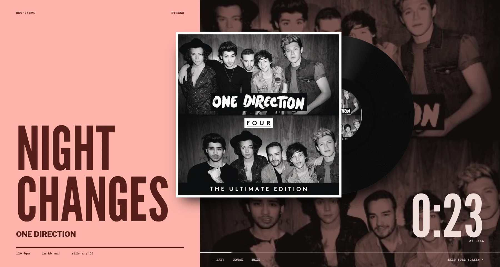
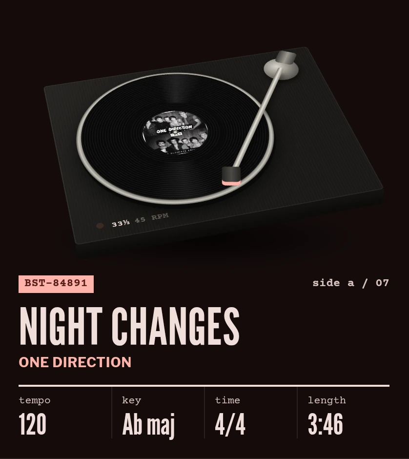
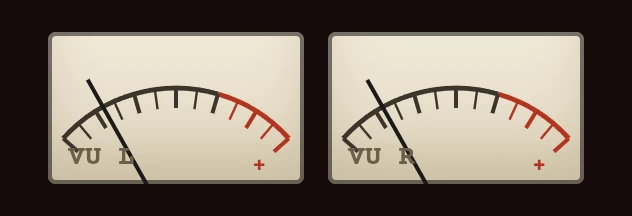
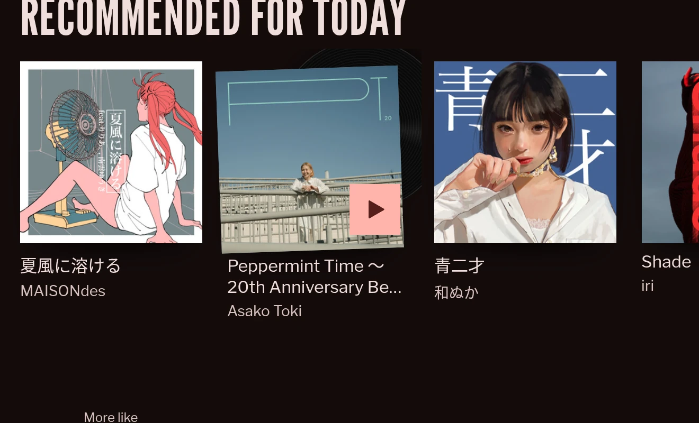
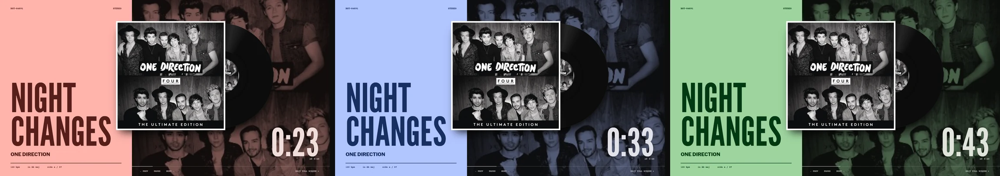
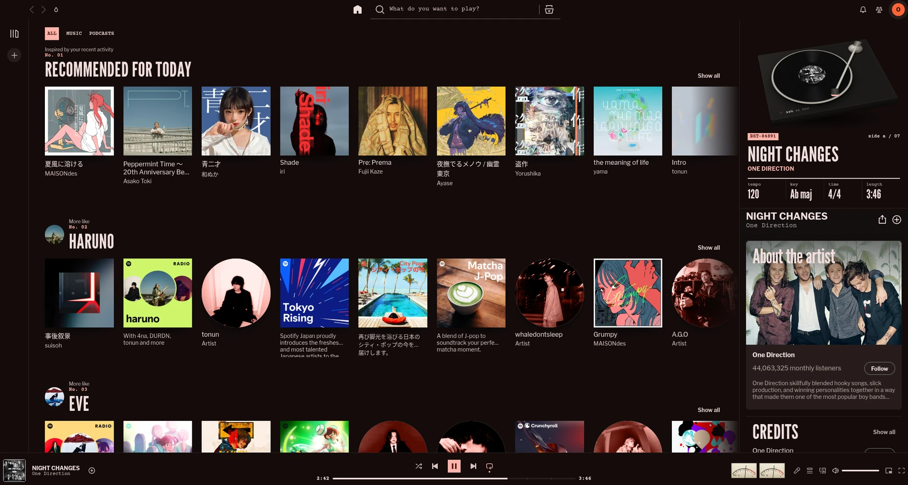

<p align="center">
  
</p>

<h1 align="center">needledrop</h1>

<p align="center">
  A <a href="https://spicetify.app">Spicetify</a> theme that treats Spotify like a record.<br>
  Blue Note–style sleeves, a working turntable, analog VU meters, and an ink color that follows your wallpaper.
</p>

<p align="center">
  
  
  
  
</p>

---

## The idea

Reid Miles designed hundreds of Blue Note sleeves between 1956 and 1967. He worked with a few tools: condensed gothic type set huge, a single flat ink, duotone photography, and a typewriter catalog number in the corner. needledrop borrows that vocabulary and applies it to Spotify's interface, then adds the parts of a record player that a sleeve can't have: a platter that spins, an arm that follows the groove, and needles that move with the music.

## Features

### Full-screen sleeve poster

Spotify's full-screen view becomes a record sleeve. The track title is set in League Gothic and fitted to the color block, the cover is reprinted as a duotone behind it, and the record slides out of the sleeve and spins at 33⅓ rpm. On every track change the record slides back in, the type drops, and the next sleeve comes out.

### A turntable in the sidebar



The cover art in the Now Playing panel is replaced by a 3D turntable built in CSS.

- The platter turns at a true **33⅓ rpm** (1.8 s per revolution). It spins up and slows down with inertia on play and pause.
- The **tonearm tracks the song**. It cues to the lead-in groove, moves inward as the track plays, lifts on pause, and returns to its rest when the track changes.
- The label underneath carries real data from Spotify's audio analysis: **tempo, key, time signature** and length. It also shows a stable per-track catalog number in the Blue Note `BST-84xxx` style.

<br clear="right">

### Analog VU meters



Two VU meters sit in the player bar. Their needles follow the **loudness of each audio segment** of the track: they rise on the attack and fall back slowly, like a real meter. The needles are animated on the compositor, so they do not compete with Spotify for the main thread.

### Sleeves on the shelf



Album and playlist cards are sleeves. Hover over one and its record slides out. Artist photos are printed as ink duotones and return to full color under the cursor. Section headings are numbered like a catalog: `No. 01`, `No. 02`…

### Colors that follow your wallpaper



If you use [matugen](https://github.com/InioX/matugen) to theme your desktop, needledrop takes its ink from the same palette as your terminal border and compositor. When you change wallpaper, Spotify recolors **live**. You don't need to run `spicetify apply` or restart anything.

You can switch the ink source with the drop icon in the top bar:

| Ink source | Behaviour |
| --- | --- |
| **wallpaper** (default) | `primary` / `on_primary` / surfaces from matugen, so the theme matches the rest of your desktop |
| **cover art** | the most vivid color of each track's cover, so the theme changes with every song |

### The rest of the interface



- Panels sit edge to edge and are separated by hairlines, not floating rounded cards.
- Type is League Gothic for display, Libre Franklin for text, and Courier Prime for numbers and metadata.
- Square cover art throughout, with hard ink-colored block shadows instead of blurs.
- Track rows get an ink bar on hover.
- An ink rule sweeps across the main view on every page change.

## Install

**Requirements:** Spotify desktop and [Spicetify](https://spicetify.app) 2.45 or newer. matugen is optional.

```sh
git clone https://github.com/Oatse/needledrop.git
cd needledrop
./install.sh
```

| Option | What it does |
| --- | --- |
| `--matugen` | registers a matugen template so Spotify follows your wallpaper |
| `--no-restart` | applies without restarting Spotify (use this with **Flatpak** Spotify, then reopen it yourself) |
| `--link` | symlinks the theme files instead of copying them, so edits to the repo apply after `spicetify refresh` |
| `--uninstall` | switches Spicetify back to the stock look |

<details>
<summary><b>Manual install</b></summary>

```sh
mkdir -p ~/.config/spicetify/Themes/needledrop
cp theme/* ~/.config/spicetify/Themes/needledrop/
spicetify config current_theme needledrop color_scheme needledrop inject_theme_js 1
spicetify apply
```

</details>

<details>
<summary><b>Wallpaper colors with matugen (manual)</b></summary>

1. Copy `matugen/spotify-needledrop.json` to `~/.config/matugen/templates/`.
2. Add this to `~/.config/matugen/config.toml`, replacing `SPOTIFY` with the output of `spicetify config spotify_path`:

   ```toml
   [templates.spotify-needledrop]
   input_path = '~/.config/matugen/templates/spotify-needledrop.json'
   output_path = '~/.config/spicetify/Themes/needledrop/assets/nd-wallpaper.json'
   post_hook = 'cp ~/.config/spicetify/Themes/needledrop/assets/nd-wallpaper.json "SPOTIFY/Apps/xpui/assets/"'
   ```

3. Change your wallpaper (or run matugen once). The theme checks the palette every few seconds.

</details>

## Troubleshooting

<details>
<summary><b>Flatpak Spotify: logged out or a broken window after <code>spicetify apply</code></b></summary>

Without `-n`, Spicetify restarts Spotify by launching its binary directly, outside the Flatpak sandbox. That copy of Spotify uses a different profile, so you appear logged out. Use `spicetify apply -n` (or `./install.sh --no-restart`) and reopen Spotify from your launcher or with `flatpak run com.spotify.Client`.

</details>

<details>
<summary><b>Wayland with fractional scaling: blurry or shrunken window, misaligned clicks</b></summary>

Run Spotify natively on Wayland, but let the compositor do the scaling. For Flatpak, put these lines in `~/.var/app/com.spotify.Client/config/spotify-flags.conf`:

```
--enable-features=UseOzonePlatform,WaylandWindowDecorations
--disable-features=WaylandFractionalScaleV1
--ozone-platform=wayland
```

</details>

<details>
<summary><b>The tempo/key panel shows "—"</b></summary>

These values come from Spotify's audio analysis, which some tracks (podcasts, local files, very new releases) don't have. The VU meters rest in that case too.

</details>

## How it stays smooth

Spotify's interface is a large React app, so a theme with this much motion has to stay out of its way. needledrop follows these rules:

- **Overlays live outside React.** The turntable, VU meters and poster are mounted on `<body>` and positioned against Spotify's elements. Inserting nodes into Spotify's own tree makes React drop panels.
- **Few animations, kept running.** On a page this heavy, *creating* animations is what costs main-thread time, not running them. The VU meters schedule one animation per 3-second window with a keyframe per audio segment. The tonearm is a single linear animation from now to the end of the track. Both run on the compositor.
- **Layout is never forced mid-script.** Overlay positions update from `ResizeObserver` and in the next frame. The poster title is fitted with `canvas.measureText` rather than by measuring the DOM. Spotify's own cinema view is skipped with `content-visibility: hidden` while the poster covers it.
- **Work happens ahead of time.** Cover colors, audio analysis and the duotone are cached per track. The next track in the queue is prepared before it plays, so track changes render in one frame without flicker.

## Customising

All colors and type are CSS custom properties at the top of [`theme/user.css`](theme/user.css). Some useful ones:

| Variable | Default | Used for |
| --- | --- | --- |
| `--nd-accent` | from wallpaper / cover | ink: color block, play button, labels |
| `--nd-ink` | `#0d0d0c` | background |
| `--nd-paper` | `#f1ece1` | text |
| `--nd-gothic` | League Gothic | display type |
| `--nd-type` | Courier Prime | numbers & metadata |

`prefers-reduced-motion` is respected. The record, arm and poster choreography are disabled when your system asks for less motion.

## Credits

- Visual language after **Reid Miles**' sleeves for Blue Note Records. needledrop is not affiliated with Blue Note Records or Spotify.
- Fonts: [League Gothic](https://www.theleagueofmoveabletype.com/league-gothic), [Libre Franklin](https://github.com/impallari/Libre-Franklin) and [Courier Prime](https://quoteunquoteapps.com/courierprime/), all under the SIL Open Font License, loaded from Google Fonts.
- Built on [Spicetify](https://spicetify.app). Wallpaper palettes come from [matugen](https://github.com/InioX/matugen).

## License

[MIT](LICENSE) © 2026 Oatse
